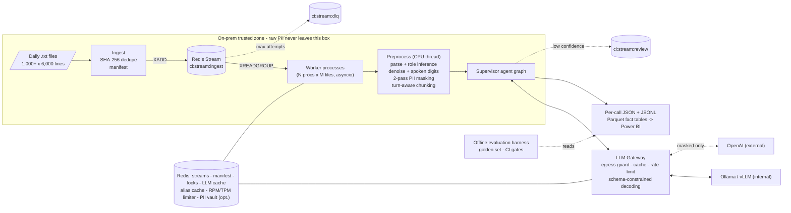
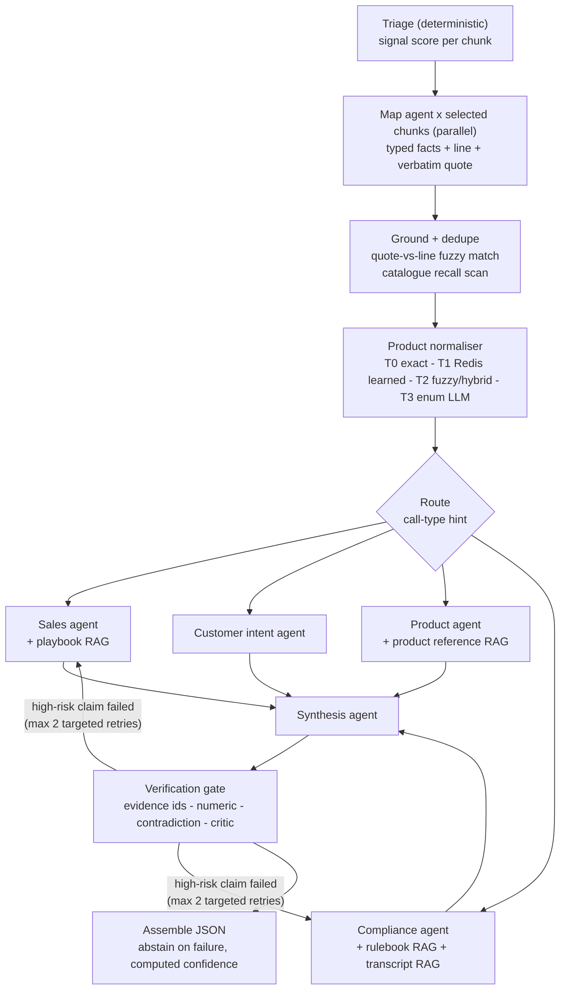

# CallIntel v3: architecture review and design

This document reviews the v2 diagram ("Banking Call Transcript Analysis Framework, Detailed Agentic RAG Architecture (v2)"), lists the changes made in v3, and explains how each requirement is met in the code.

## 1. Review of v2

v2 already gets the important decisions right: PII is masked locally before anything reaches an LLM, transcripts are chunked and analysed in parallel with line references, insights are verified against evidence, prompts are kept static so prefix caching works, and evaluation is a separate CI harness. v3 keeps all of that. The changes below fix concrete problems in latency, cost, correctness, and operations.

| # | v2 | Problem | v3 change | Where |
|---|----|---------|-----------|-------|
| 1 | Celery/ARQ workers **and** Redis Streams | Two queueing systems doing one job. Celery's prefork model also fits poorly with asyncio LLM I/O. | **Redis Streams consumer groups only.** XREADGROUP + XAUTOCLAIM (recovers work from crashed workers) + retry counter + DLQ. Level-1 parallelism is OS processes; level-2 is asyncio. | `redis_layer/streams.py`, `pipeline/worker.py` |
| 2 | Map agent over every chunk, then four specialists | Specialists re-reading raw text multiplies LLM calls. | **One multi-aspect map call per chunk** produces typed atomic facts. Specialists reason over the compact, de-duplicated fact list (roughly 50x fewer tokens than the transcript). | `agents/mapper.py`, `agents/specialists.py` |
| 3 | Every chunk goes to the LLM | Long calls are mostly hold time, verification and small talk. | **Deterministic triage**: lexicon and catalogue signal score per chunk; low-signal chunks skip the map call. The first and last chunks are always kept. A deterministic catalogue scan still catches product names inside skipped chunks. | `agents/triage.py`, `supervisor._ingest_facts` |
| 4 | Agents write quotes, then a span matcher checks them | Reduce agents can still invent quotes. | **Evidence by reference**: reduce agents can only cite ids (`F12` = grounded fact, `L1203` = transcript line). Unknown ids are caught mechanically. Only the map step writes quotes, and each quote is fuzzy-matched to its line before it becomes a fact. | `agents/context.py` (EvidenceRegistry) |
| 5 | Confidence threshold >= 0.75 | LLM self-reported confidence is poorly calibrated. | **Computed confidence** = grounding score x evidence support x critic verdict. | `verify/grounding.py` |
| 6 | Critic on "compliance & rates" | No check that a "missed disclosure" is really missing, and no numeric check. | **Contradiction probe** (a "missed" rule is re-searched in the transcript), **numeric fidelity** (stated rates and fees must appear in the cited lines), and the critic runs **only on high-risk claims**, batched (1-3 calls per file). | `verify/gate.py`, `agents/critic.py` |
| 7 | PII masked once, at Stage 2 | A masking bug becomes a data leak. Spoken numbers ("nine eight double seven...") get past regexes. | **Spoken-digit normalisation** before detection, **dialogue-aware detection** (the answer that follows "your date of birth?" is masked), **two-pass masking** (a name used before the introduction is still masked), plus an **egress guard** in the gateway that re-scans every outbound prompt and blocks it, and an **output PII scan**. | `preprocess/cleaning.py`, `preprocess/pii.py`, `llm/egress.py`, `pipeline/engine.py` |
| 8 | Qdrant for product normalisation | The catalogue holds hundreds of entries, so a separate vector DB adds operational cost for little gain. | **In-process hybrid index** (BM25 + optional dense, RRF fusion; well under 1 ms per query) behind the same `search()` interface. Redis 8 vector search or Qdrant can be swapped in when the KB grows. | `rag/retrieval.py` |
| 9 | RAG used only for product normalisation | Compliance judgements were not grounded in the rulebook or in the actual words spoken. | RAG in three places: the **knowledge base** (compliance rules, playbook, product reference terms), **transcript RAG** (candidate lines retrieved per compliance rule, plus agent lookups), and **catalogue retrieval** for normalisation. | `rag/knowledge_base.py`, `rag/transcript_index.py` |
| 10 | "Sub-ms semantic cache" for RAG/LLM | Semantically caching *extraction answers* can copy one call's facts into another call (contamination). | **Exact-match, content-addressed cache only** (provider + model + params + schema + messages). Semantic reuse is limited to alias normalisation, which is safe because it is call-independent. | `llm/gateway.py` |
| 11 | 3-tier normaliser | Each worker re-resolves the same new alias. | **Self-learning tiers**: T2/T3 results are written to the shared Redis alias hash, so every alias is resolved slowly only once across the fleet. Unresolved mentions go to a curation stream. | `normalize/normalizer.py` |
| 12 | LangGraph supervisor | The graph is a fixed fan-out/fan-in with one bounded loop. | **Plain asyncio supervisor**: same agents, explicit control flow, no framework overhead. Agents are classes, so moving to LangGraph later only changes the wiring. Agents still decide when they need tool lookups (bounded tool loop). | `agents/supervisor.py`, `agents/base.py` |
| 13 | Ollama via the OpenAI-compatible API | The compat endpoint cannot set `num_ctx`, so long chunks are **silently truncated**. qwen3 "thinking" also adds latency. | **Native `/api/chat`** with explicit `num_ctx`, JSON-schema `format`, `think:false`, and `keep_alive`. | `llm/gateway.py` (OllamaProvider) |
| 14 | `gpt-4o-mini` / `gpt-4o` | OpenAI marks these as deprecated (gpt-4o-mini is scheduled to shut down on 14 Jan 2027). | Profiles use current models (`gpt-6-luna` for map with `reasoning_effort: none`, `gpt-6.1-terra` for reduce/critic). They are config values, so verify ids and prices before use. | `config/config.yaml` |
| 15 | Keys and values "can vary" | Free-text labels make 1,000s of calls impossible to compare. | **Controlled taxonomy** (`taxonomy.yaml`) compiled into **JSON-schema enums**, so the decoder cannot emit an off-list value. `other` plus `domain_insights.taxonomy_other_values` shows where the taxonomy needs to grow. | `schemas.py`, `config/taxonomy.yaml` |
| 16 | Throughput "4-10 s/file" | Not achievable on a laptop GPU at 6,000 lines/file (see section 7). | Explicit capacity model and deployment profiles (laptop / on-prem vLLM / OpenAI). | section 7 |
| 17 | *(found in the first real-model run)* | Map answers cut off at the token cap. Re-asking produced the same cut, and the chunk's facts were lost. | **Truncation salvage** keeps every complete item of a cut-off JSON answer. **Grammar-enforced `maxItems`** (Ollama) bounds the fact count during generation. | `llm/gateway.py`, `schemas.py` |
| 18 | *(found in the first real-model run)* | Roles sharing one Ollama model used different `num_ctx`, so every role switch reloaded the model, and one reload crashed CUDA on the 6 GB GPU. | The gateway forces **one context size per model**. The laptop profile uses **one model for all roles**, and Ollama concurrency matches `OLLAMA_NUM_PARALLEL`. | `llm/gateway.py`, `config.yaml` |
| 19 | *(found in the first real-model run)* | A quote can be verbatim yet irrelevant ("Can you repeat that?" cited as the call intent). Non-product phrases ("debit transaction") were fuzzy-matched to products. | The critic now also checks **primary intent**. A **head-noun guard** stops non-product phrases before fuzzy or LLM matching. Atomic facts are written to the output for audit and BI. | `verify/gate.py`, `normalize/normalizer.py` |
| 20 | *(found with the 4B model)* | Long calls repeat one utterance template many times (hold loops, statement read-outs). A small model spends its fact budget on them and misses the actual intent. | **Repetition compression** keeps each 5+-word template (numbers ignored) at most twice per speaker; short answers ("yes", "I agree") are never touched. On 6,000-line test calls, tokens fell 82% (from 49% before). The map request also ends with a short recency reminder for small models. | `preprocess/transcript.py`, `config/prompts.yaml` |
| 21 | *(found by the golden-set evaluation)* | The small model tagged the agent's own APR disclosure as a customer objection in almost every call, and missed single decisive lines (the reason for calling, "call me back next week"). | **Speaker rules**: objection, complaint, intent, need and buying-signal facts must come from the customer; offers and identity checks from the agent. The speaker of every line is known, so this check is deterministic. **Transcript RAG for headline judgements**: the customer and sales agents also see cue-retrieved candidate lines (intent and outcome), citable as `L<n>`. | `agents/supervisor.py`, `agents/specialists.py` |

## 2. v3 architecture

### Per-call agent graph

Agents short-circuit when their slice is empty. If there are no sales facts, the sales agent returns `no_pitch` without an LLM call.

## 3. Requirement-by-requirement

| Requirement | Implementation |
|---|---|
| 1. Consistent JSON | `CallAnalysis` (fixed core) plus `domain_insights` (extensible). Every categorical value is an enum from `taxonomy.yaml`. Every claim carries `evidence[{line, speaker, quote}]` and a computed `confidence`. Export the JSON Schema with `python -m callintel schema`. |
| 2. Agentic | Supervisor routing; specialist agents; agents request lookups (`search_transcript`, `get_lines`, `search_kb`) through a bounded tool loop; critic agent; targeted self-correction retries. |
| 3. RAG | Hybrid BM25+dense retrieval over the KB (rules, playbook, product terms), per-call transcript RAG for compliance and the critic, and catalogue retrieval for normalisation. |
| 4. Speed on 6,000-line files | Denoise (about 40-50% fewer tokens), triage (skips low-signal chunks), one map call per chunk, specialists on facts, parallelism at every level, and a content-addressed cache (re-runs are near-instant). |
| 5. Product normalisation + PII | 3-tier self-learning normaliser. Product names are protected from NER masking. Layered local PII masking plus the egress guard. |
| 6. Local + configurable LLM | Profiles in `config.yaml`; switch with `CALLINTEL_PROFILE=openai`. The API key goes in `.env` or inline in config. |
| 7. Performance | See section 7. |
| 8. Redis | Streams, consumer groups, DLQ, review queues, manifest, locks, LLM and embedding cache, learned alias hash, Lua token-bucket RPM/TPM limiter, encrypted PII vault, daily metrics. |
| 9. Optimised prompts | `config/prompts.yaml`. See section 6. |
| 10. Parallel files | N processes x M concurrent files x concurrent chunk calls, bounded by provider semaphores and the shared rate limiter. |
| 11. Noise | Tags, fillers, stutters, duplicated ASR segments, IVR prompts, and backchannel-only lines are removed. Meaning-bearing "yes/no/okay" is kept. Spoken digits are normalised. |
| 12. Hallucinations | 8 layers (see `verify/gate.py` docstring). The rule is to abstain rather than invent. |
| 13. Evaluation | Separate `evaluation/` package with a golden set, standard metrics, CI gates, a baseline regression check, an optional LLM judge, and RAGAS export. |

## 4. PII design

1. **Spoken-digit normalisation** turns "nine eight double seven ..." into `98877...`, so checksum regexes can see numbers that were read out.
2. **Regex layer** handles card (Luhn), Aadhaar (Verhoeff), PAN, IFSC, UPI, IBAN, SSN, phones, email, and a catch-all for runs of 9 or more digits.
3. **Context layer** handles names after cue phrases (with speaker role, giving `<CUST_NAME_n>` or `<AGENT_NAME_n>`), account numbers, OTP/CVV/PIN, DOB, address, PIN code, reference IDs, and spoken email ("rahul dot sharma at gmail dot com").
4. **Dialogue-aware layer**: a question ("your date of birth?") marks the next 1-2 answers from the other speaker for that entity type.
5. **NER layer (optional)**: Presidio and GLiNER, run only on *gated* lines (cue words or capitalised tokens), which avoids running a transformer on all 6,000 lines.
6. **Two-pass masking with gazetteer**: names learned anywhere in the call are masked everywhere. Surrogates are consistent within a call.
7. **Protection list**: catalogue product names and `allow_terms` (the bank's name) are never masked by NER.
8. **Egress guard**: every prompt to an `external` provider (configurable to all providers) is re-scanned. A finding blocks the request (default) and sends the file to the DLQ, never to the cloud. `privacy.allow_cloud_llm: false` is a hard local-only switch.
9. **Output scan**: insights are scanned before they are written. Any finding is redacted and the call is flagged for review.
10. **Vault (off by default)**: Fernet-encrypted surrogate-to-value mapping with a TTL. The key is held outside Redis.

Raw text exists only in worker memory. Redis, logs, prompts, and outputs see only masked text. Audit logs record entity *types and counts* only.

## 5. Hallucination controls

Constrained decoding, then evidence-by-reference, then span grounding, then numeric fidelity, then the contradiction probe, then the critic, then targeted retry, then abstain. The output records what happened: `quality.claims_dropped_ungrounded`, `critic_checked`, `critic_rejected`, `retries`, `review_items`, and `status: validated | needs_review`. Calls marked `needs_review` are also pushed to `ci:stream:review`.

## 6. Prompt optimisation

- Static system prompt first and dynamic data last, with taxonomy lists rendered once. This keeps the prefix byte-identical, so OpenAI prompt caching, vLLM prefix caching, and Ollama KV reuse all hit.
- No JSON examples in prompts. Structure is enforced by schema-constrained decoding, so prompts only explain field meaning. Field order is set so that generation follows type, then line, then quote, then summary.
- Compact input format: `1203|C: text` (3-4 tokens of overhead per turn instead of about 10).
- Word limits on every free-text field, because output tokens dominate latency.
- An explicit abstain path in every prompt ("unclear", empty lists).
- Speaker is derived from the line number, not generated, which saves tokens and removes a class of errors.
- Prompts are versioned. The cache key includes a content hash, and `processing.prompt_versions` is recorded in every output.

## 7. Performance and capacity

Per 6,000-line call (measured on synthetic calls; real calls vary): 65.8k raw tokens became 12.1k after denoising and repetition compression (82% less). That left 6 chunks, of which triage sent 3 to the LLM, for 17 LLM calls in total (22k tokens in, 7.8k out).

| Deployment | Throughput (estimate) | 1,000 files/day? |
|---|---|---|
| Laptop: RTX 3060 6 GB, Ollama, qwen3 4B (measured) | 133 s per 6,000-line call, about 27 calls/hour | No (about 650/day at 24 h). Development, testing, small batches. |
| On-prem GPU server: vLLM + Qwen3-30B-A3B-Instruct (MoE) on 1x 48-80 GB GPU | continuous batching, thousands of tok/s aggregate | Yes, in a few hours per day |
| OpenAI (gpt-6-luna map, gpt-6.1-terra reduce) | limited by RPM/TPM tier; 48 concurrent requests by default | Yes, under 1 hour per day |

Levers, in order of impact: triage threshold, chunk size (raise to 6k+ tokens for cloud models), map model size, `files_per_process`, provider `max_concurrency`, and critic scope.

## 8. Redis keyspace

See the docstring of `callintel/redis_layer/client.py`. Production: Redis 8 with AOF, `maxmemory-policy volatile-lru` (cache keys have TTLs; queues and manifest do not), and TLS/ACL when Redis runs on another host.

## 9. Evaluation

`python -m evaluation.run_eval --profile 
` runs the pipeline on `evaluation/golden` and scores:

- **Privacy:** leakage count (hard gate 0), masking recall, product-name preservation.
- **Schema:** schema validity, enum validity.
- **Normalisation:** mention accuracy, call-level product P/R/F1, hallucinated-product rate.
- **Grounding:** evidence grounding rate, hallucination rate.
- **Extraction:** call type, intent, outcome, identity and compliance accuracy; objection F1.
- **Ops:** latency p50/p95, LLM calls, tokens, cache hit rate, estimated cost.

It also offers an optional LLM-judge (`--judge`) and a RAGAS/DeepEval dataset export (`--export-ragas`). Gates live in `evaluation/thresholds.yaml`. Use `--save-baseline` once, and later runs fail on regressions.
